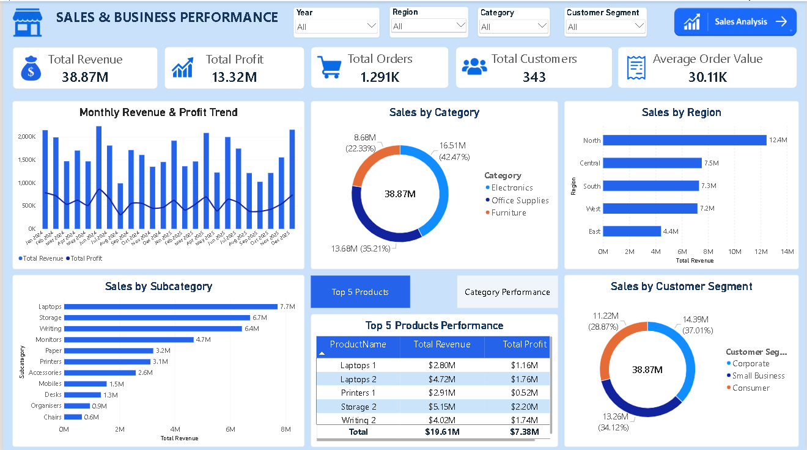
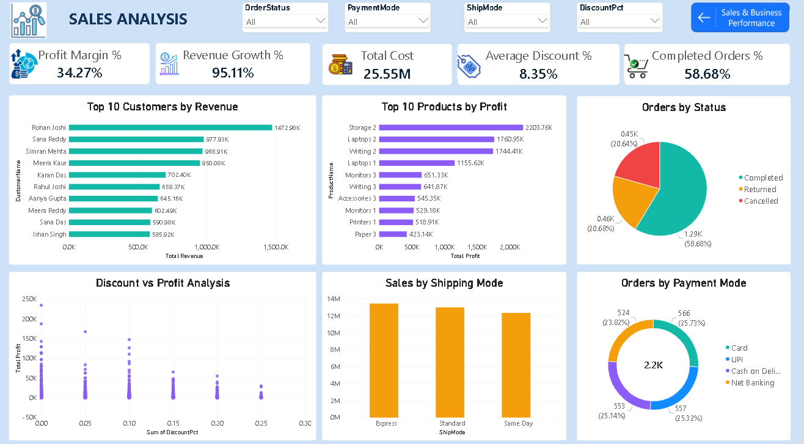

# Sales-Business-Performance-Dashboard

Power BI Sales and Business Performance Dashboard

## Project Overview
An interactive Power BI dashboard developed to analyze sales, profit, customer segments, product performance, and overall business performance.

## Dashboard Pages

### Page 1 – Sales Overview
- Total Sales and Total Profit
- Sales by Region
- Sales by Customer Segment
- Top 5 Products
- Category Performance

### Page 2 – Business Performance
- Profit Margin %
- Revenue Growth %
- Total Cost
- Average Discount %
- Completed Orders %

## Tools Used
- Power BI Desktop
- Power Query
- DAX
- Excel

## Project Files
- Sales_Business_Performance_Dashboard.pbix
- Sales_Business_Performance_Dataset.xlsx

## How to View
Download the Power BI report (.pbix) and open it using Power BI Desktop.

## Dashboard Preview

### Page 1 – Sales Overview

### Page 2 – Business Performance

